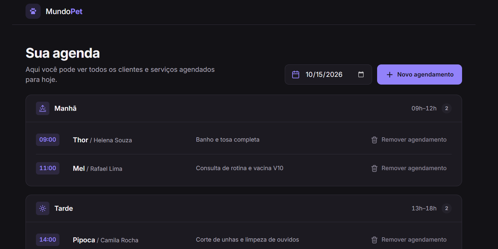

# 🐾 Mundo Pet — Agendamento para Pet Shop

Site responsivo de agendamento de atendimentos para pet shop, feito com HTML, CSS e JavaScript puro. Projeto do desafio da **Rocketseat (Formação Full-Stack, Módulo 1)**.



## Funcionalidades

- Agenda do dia dividida em **Manhã (09h–12h)**, **Tarde (13h–18h)** e **Noite (19h–21h)**, com ícone, faixa de horário e contador por período.
- Filtro por data no topo. A página abre com a data de hoje.
- Agendamentos ordenados por horário dentro de cada período, mostrando horário, pet, tutor e serviço.
- Estado vazio amigável quando um período não tem agendamentos.
- Modal **"Agende um atendimento"** com:
  - foco inicial no primeiro campo, *focus trap*, fechamento por ESC, pelo botão X ou por clique no overlay;
  - devolução do foco para o botão que abriu o modal;
  - fundo bloqueado (overlay, scroll travado e conteúdo de trás inerte).
- Validação própria em JavaScript, com uma mensagem embaixo de cada campo, `aria-invalid` e `aria-describedby`.
- Máscara de telefone: `(00) 0 0000-0000` para celular e `(00) 0000-0000` para fixo.
- Seleção de horário só entre os horários válidos. Os já ocupados ou que já passaram ficam desabilitados.
- Remoção imediata de agendamentos, sem confirmação.
- Persistência em `localStorage` e dados de exemplo na primeira execução.
- Layout mobile-first (de 360px a 1440px+), tema escuro e animações sutis que respeitam `prefers-reduced-motion`.

## Tecnologias

- HTML5 semântico
- CSS3 (custom properties, grid, flexbox, `<dialog>`, `mask` para os ícones SVG)
- JavaScript puro com ES Modules
- `localStorage`
- Fonte [Inter](https://fonts.google.com/specimen/Inter) (Google Fonts)

O projeto não tem framework, bundler nem dependências de npm.

## Como rodar

Os scripts usam **ES Modules** (`<script type="module">`). Por segurança (CORS), os navegadores bloqueiam módulos carregados de `file://`, então abrir o `index.html` com dois cliques **não funciona**. Use um servidor local:

**Opção 1 — VS Code + Live Server**

1. Instale a extensão **Live Server**.
2. Clique com o botão direito no `index.html` e escolha **"Open with Live Server"**.

**Opção 2 — Terminal (Node.js)**

```bash
npx serve .
```

Depois, abra o endereço que aparecer no terminal (ex.: `http://localhost:3000`).

## Estrutura

```
├── index.html
└── src/
    ├── styles/   global.css (tokens e reset) · header.css · schedule.css · modal.css
    ├── scripts/  main.js · storage.js · schedule.js · modal.js · form.js · utils.js
    └── assets/icons/  SVGs (patinha, sol nascendo, sol, lua, lixeira, calendário…)
```

## Regras de negócio implementadas

- **Campos obrigatórios:** tutor (mín. 3 caracteres), pet (mín. 2), telefone (10 ou 11 dígitos), descrição do serviço, data e hora.
- **Datas passadas** não são aceitas.
- **Janela de atendimento:** só horários cheios de 09h a 21h. O JavaScript valida isso no envio, então um horário injetado pelo DevTools também é rejeitado.
- **Horários passados:** na data de hoje, o horário cheio que já começou fica indisponível.
- **Sem conflito:** dois agendamentos não podem ter a mesma data e hora. A checagem acontece em três lugares: no `<select>` (opção desabilitada), na validação do envio e na camada de `storage` antes de gravar.
- Ao agendar para outra data, a agenda do topo passa a mostrar essa data.
- Cada agendamento tem um `id` gerado por `crypto.randomUUID()`. O modelo de dados é:
  ```js
  { id, tutor, pet, phone, service, date: "YYYY-MM-DD", time: "HH:MM" }
  ```
- **Fuso horário:** as datas são montadas no horário local (`new Date(ano, mês - 1, dia)`). O código nunca usa `new Date("YYYY-MM-DD")`, que é interpretado em UTC.
- **Segurança:** os dados do usuário entram no DOM só via `textContent`/`createElement`, nunca via `innerHTML`.
- **Dados de exemplo:** 5 agendamentos na data de hoje, criados uma única vez (controlado pela flag `mundo-pet:seeded`).

## Decisões tomadas

- **Nome e identidade:** como não havia layout de referência, criei a marca "Mundo Pet" com uma patinha em SVG e um tema escuro com destaque roxo (`#9282fa`).
- **`<dialog>` nativo com `showModal()`:** ele já deixa o fundo inerte e cria o overlay. O focus trap, a animação de saída no ESC e o clique no overlay foram implementados por cima.
- **Ícones como arquivos `.svg` usados via `mask`:** cada ícone fica em um arquivo próprio e herda a cor do texto (`currentColor`), o que facilita trocar o tema.
- **Subtítulo dinâmico:** em hoje, o subtítulo usa o texto pedido ("…agendados para hoje."). Em outras datas, mostra a data por extenso, para não dizer "hoje" quando não é.
- **Data do modal:** o modal vem preenchido com a data do topo. Se essa data estiver no passado, ele usa hoje, já que datas passadas não são aceitas.
- **Horários passados de hoje:** considerei "já passou" o horário cheio cuja hora já começou (às 10h30, o horário das 10:00 fica indisponível).
- **Telefone fixo:** a máscara se adapta a 10 dígitos (`(00) 0000-0000`), porque a regra aceita 10 ou 11 dígitos.
- **Tamanho mínimo da descrição:** o serviço exige pelo menos 3 caracteres, para evitar descrições como "a".
- **Fechar sem agendar** limpa as mensagens de erro, mas mantém o rascunho digitado. O formulário só é zerado depois de um agendamento feito com sucesso.
- **Botão "Remover agendamento":** no desktop mostra ícone e texto. No mobile mostra só o ícone (o `aria-label` descreve a ação, com o nome do pet e o horário).
- **Foco após remover:** o foco vai para o próximo item da seção (ou para o título dela), para que quem navega pelo teclado não perca a posição.
- **Anúncios para leitores de tela:** uma região `aria-live` avisa quando um agendamento é criado ou removido.
- O arquivo `PROMPT.md` (instruções locais usadas para gerar o projeto) foi deixado fora do repositório pelo `.gitignore`.

## Próximos passos / melhorias

- Editar um agendamento existente.
- Desfazer a remoção com um *toast* ("Agendamento removido · Desfazer").
- Busca por pet ou tutor e visão semanal.
- Mostrar o telefone no card, com link `tel:` / WhatsApp.
- Duração variável por tipo de serviço (ex.: banho e tosa ocupando 2 horas).
- Back-end com API e banco de dados para sincronizar entre dispositivos.
- Testes automatizados (unitários para `utils.js` e E2E com Playwright).
- Tema claro alternável.

## Repositório

https://github.com/lopesdz7/agendamento-petshop
